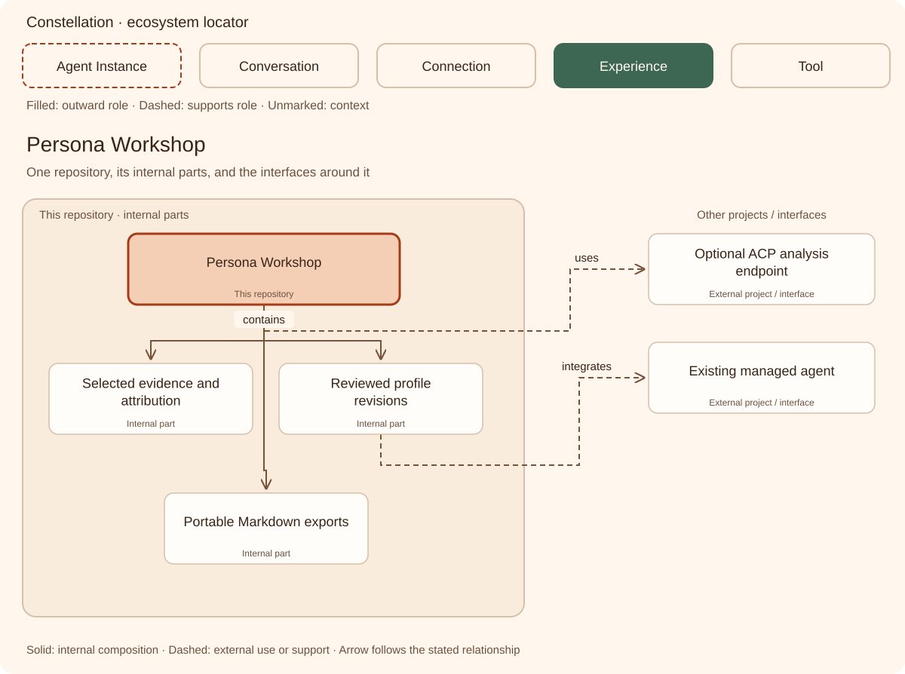

# Persona Workshop

Create communication and working-style profiles from selected evidence. Import
transcripts, chats, notes or documents; review who said what; then build and refine
two portable Markdown profiles: **how someone communicates** and **how they think
and work**. Export the profiles or apply a reviewed version to an existing agent.

Part of [Amplifier Constellation](https://github.com/microsoft/amplifier-constellation).

## Get started

Download the matching [Persona Workshop release](https://github.com/microsoft/amplifier-persona-workshop/releases)
for Windows 11, macOS or Linux. Extract the complete package and open
**Persona Workshop**. It opens in your browser on this computer; choose a workshop
password and optionally enable start at sign-in.

No Python, Rust, WSL or document-converter installation is needed. Preview packages
are unsigned and not notarized. Your projects and evidence stay in the current
user's private application-data folder and remain available when you reopen the app.

Manual review, profile compilation and export work without an analysis endpoint.
Automated extraction and scenario generation require a configured ACP endpoint;
recording transcription requires a separate configured provider. See
[configuration](docs/configuration.md) for setup and supported documents.

To update, open your installed workshop, then the complete newer download, and
choose **Update Persona Workshop**. Keep an interrupted installation and its
saved records for recovery rather than deleting or recreating it.

## Build a profile

1. Create a subject and identify their speaker labels in the source material.
2. Add authored communication to **Communication**, and decision or work evidence
   to **Thinking and working**.
3. Review attribution and select excerpts. Exclude assistant output and quoted
   material that should not represent the person.
4. Choose **Create profiles**, review the saved instructions and edit or exclude
   individual rules. Rebuilding preserves your review decisions.
5. Use **Try it** or **Compare blind** with a situation you know, and save feedback.
6. Choose **Use on agent…** to apply the reviewed files to a compatible existing
   agent, or **Export…** for AGENTS.md, SOUL.md or the native profile package.

Draft edits never change a running agent automatically. Applying a profile requires
the agent's separate management connection; a generic ACP connection alone is not
enough. Review existing AGENTS.md or SOUL.md instructions before combining exports.

## Keep evidence and results in context

Selected evidence is sent to your configured model endpoint for analysis, so its
account and retention policies apply. Use an appropriately restricted analysis
agent for untrusted material. Scanned PDFs require OCR before import.

A profile is guidance, not a verified replica of a person. Attribution and feedback
need human review; generated examples are not automatically treated as evidence.

## Help and integration

- [Local/remote configuration and existing Linux installations](docs/configuration.md)
- [Portable exports and preserving existing instructions](docs/portable-exports.md)
- [Profile content](docs/profile-content.md) and [API/automation](docs/ui-api-contract.md)
- [Contributor entry](AGENTS.md)

<!-- ecosystem-map:start -->
## Where this fits

A profile-authoring experience that exports guidance or applies reviewed profiles through agent management.

Roles: Experience. Supports: Agent Instance.

[Open the map](docs/ecosystem-map.svg) · [Product overview](https://microsoft.github.io/amplifier-constellation/projects/amplifier-persona-workshop/) · [Map guide](https://github.com/microsoft/amplifier-constellation/blob/main/docs/ecosystem-maps.md)

The five shared building blocks

<!-- ecosystem-map:end -->

## Contributing

Invited collaborators: follow [Join the work](https://github.com/microsoft/amplifier-constellation#join-the-work)
within your agreed access and scope. The notice below covers general public intake.

> [!NOTE]
> This project is not currently accepting external contributions, but we're actively working toward opening this up. We value community input and look forward to collaborating in the future. For now, feel free to fork and experiment!

Most contributions require you to agree to a
Contributor License Agreement (CLA) declaring that you have the right to, and actually do, grant us
the rights to use your contribution. For details, visit [Contributor License Agreements](https://cla.opensource.microsoft.com).

When you submit a pull request, a CLA bot will automatically determine whether you need to provide
a CLA and decorate the PR appropriately (e.g., status check, comment). Simply follow the instructions
provided by the bot. You will only need to do this once across all repos using our CLA.

This project has adopted the [Microsoft Open Source Code of Conduct](https://opensource.microsoft.com/codeofconduct/).
For more information see the [Code of Conduct FAQ](https://opensource.microsoft.com/codeofconduct/faq/) or
contact [opencode@microsoft.com](mailto:opencode@microsoft.com) with any additional questions or comments.

## Trademarks

This project may contain trademarks or logos for projects, products, or services. Authorized use of Microsoft
trademarks or logos is subject to and must follow
[Microsoft's Trademark & Brand Guidelines](https://www.microsoft.com/legal/intellectualproperty/trademarks/usage/general).
Use of Microsoft trademarks or logos in modified versions of this project must not cause confusion or imply Microsoft sponsorship.
Any use of third-party trademarks or logos are subject to those third-party's policies.
